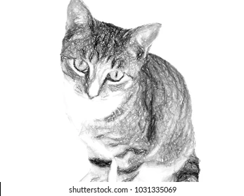
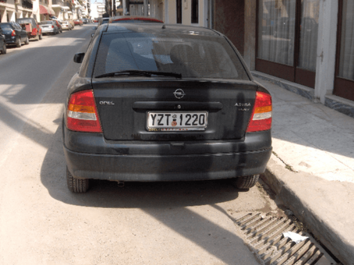

# Program Pengolahan Citra Digital (PCD)

Repository ini berisi kumpulan program dan modul pembelajaran **Pemrograman Citra Digital** menggunakan bahasa pemrograman **Python**. Proyek ini dirancang secara modular dan interaktif menggunakan sistem menu berbasis terminal, memanfaatkan pustaka populer seperti **OpenCV**, **NumPy**, dan **Matplotlib**.

## Struktur Direktori Proyek

```text
│   .gitignore
│   program_menu.py
│   README.md
│
├───assests
│       gambar.png
│       grayscale.png
│       image.jpg
│       image.png
│       mobil.png
│
├───modules
│       checkPcd.py
│       closing_ops.py
│       dilation_ops.py
│       edge_detection.py
│       function.py
│       gradient_ops.py
│       hitung_histogram.py
│       image_blur.py
│       image_blurring.py
│       image_morphology.py
│       image_normalization.py
│       image_resizing.py
│       image_rotation.py
│       image_shearing.py
│       image_translation.py
│       kalkulator.py
│       morphological_hats.py
│       morphological_ops.py
│       opening_ops.py
```

## Scaffold Proyek

Struktur ini dibuat agar setiap operasi pengolahan citra dipisah sesuai fungsinya, sehingga mudah dikembangkan dan dipelajari:

- `program_menu.py`: file utama yang menampilkan menu interaktif untuk menjalankan berbagai operasi citra.
- `modules/`: berisi modul-modul fungsi seperti resizing, rotation, blurring, edge detection (Prewitt, Sobel, Canny), dan operasi morfologi.
- `assests/`: folder berisi citra pendukung untuk demo dan pengujian.

## Preview Hasil Program

Berikut contoh citra yang digunakan dalam proyek untuk melihat hasil proses pemrosesan:






## Fitur & Menu Program

Program utama (`program_menu.py`) menyediakan menu interaktif dengan pilihan operasi sebagai berikut:

1. **Image Resizing (Zoom & Scale)**: Mengubah dimensi ukuran citra menggunakan interpolasi bilinear/bicubic dan area.
2. **Image Rotation**: Memutar citra berdasarkan titik pusat dengan sudut derajat tertentu.
3. **Image Translation**: Menggeser posisi citra pada sumbu $X$ dan $Y$.
4. **Image Shearing**: Memiringkan citra secara horizontal atau vertikal.
5. **Image Normalization**: Menormalisasi nilai intensitas piksel kanal warna.
6. **Edge Detection (Prewitt, Sobel & Canny)**: Mendeteksi garis tepi objek pada citra dengan berbagai metode konvolusi seperti Prewitt, Sobel, dan Canny.
7. **Image Blurring (Gaussian)**: Menghaluskan citra menggunakan kernel Gaussian.
8. **Morphological Erosion**: Mengikis piksel objek latar depan.
9. **Morphological Dilation**: Menebalkan/memperluas piksel objek latar depan.
10. **Morphological Opening**: Menghilangkan *noise* atau bintik kecil pada citra.
11. **Morphological Closing**: Menutup lubang atau menyambungkan bagian objek yang terputus.
12. **Morphological Gradient**: Menemukan garis luar (*outline*) objek.
13. **Top Hat & Black Hat Operations**: Mendeteksi area terang pada latar belakang gelap atau sebaliknya (cocok untuk deteksi plat nomor).

## Prasyarat & Instalasi

Pastikan Anda sudah menginstal Python di komputer Anda. Jalankan perintah berikut di terminal untuk menginstal pustaka yang dibutuhkan:

```bash
pip install opencv-python numpy matplotlib

```

## Cara Menjalankan Program

1. Clone repository ini atau simpan seluruh file ke dalam satu folder lokal.
2. Pastikan gambar pendukung sudah tersedia di dalam folder `assests/`.
3. Jalankan file menu utama dari terminal:

```bash
python program_menu.py

```

##  Author

* **Muhammad Dhiyaul Atha**
* NIM: 2024573010075
* Mata Kuliah: Pemrograman Citra Digital (PCD)

